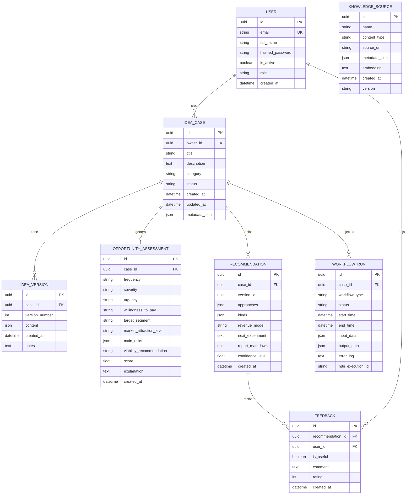

# Modelo Entidad-Relacion — HackatonMacondoLab

## Diagrama ER (Mermaid)

---

## Definicion de Entidades

### 1. User

| Atributo | Tipo | Constraints | Descripcion |
| --- | --- | --- | --- |
| `id` | UUID | PK | Identificador unico |
| `email` | String | UNIQUE, NOT NULL | Correo electronico del usuario |
| `full_name` | String | | Nombre completo |
| `hashed_password` | String | NOT NULL | Contrasena hasheada (bcrypt) |
| `is_active` | Boolean | default: `true` | Estado de la cuenta |
| `role` | String | default: `"entrepreneur"` | Rol: entrepreneur, mentor, admin |
| `created_at` | DateTime | | Fecha de creacion |

---

### 2. IdeaCase (Entidad Central)

| Atributo | Tipo | Constraints | Descripcion |
| --- | --- | --- | --- |
| `id` | UUID | PK | Identificador unico |
| `owner_id` | UUID | FK → User.id, NOT NULL | Dueno de la idea |
| `title` | String | NOT NULL | Titulo de la idea |
| `description` | Text | | Descripcion detallada |
| `category` | String | | dolor, ineficiencia, necesidad no cubierta, oportunidad, tendencia, hipotesis |
| `status` | String | default: `"new"` | Estado: new, in_progress, validated, rejected |
| `created_at` | DateTime | | Fecha de creacion |
| `updated_at` | DateTime | | Fecha de ultima actualizacion |
| `metadata_json` | JSON | | Metadatos adicionales flexibles |

---

### 3. IdeaVersion

| Atributo | Tipo | Constraints | Descripcion |
| --- | --- | --- | --- |
| `id` | UUID | PK | Identificador unico |
| `case_id` | UUID | FK → IdeaCase.id, NOT NULL | Idea a la que pertenece |
| `version_number` | Integer | default: `1` | Numero de version incremental |
| `content` | JSON | NOT NULL | Contenido refinado (problema, usuario, etc.) |
| `created_at` | DateTime | | Fecha de creacion |
| `notes` | Text | | Notas sobre los cambios de esta version |

---

### 4. OpportunityAssessment

| Atributo | Tipo | Constraints | Descripcion |
| --- | --- | --- | --- |
| `id` | UUID | PK | Identificador unico |
| `case_id` | UUID | FK → IdeaCase.id, UNIQUE, NOT NULL | Idea evaluada (1 a 1) |
| `frequency` | String | | Frecuencia del problema: low, medium, high |
| `severity` | String | | Severidad: low, medium, high |
| `urgency` | String | | Urgencia: low, medium, high |
| `willingness_to_pay` | String | | Voluntad de pago: low, medium, high |
| `target_segment` | String | | Segmento objetivo |
| `market_attraction_level` | String | | Atraccion de mercado: low, medium, high |
| `main_risks` | JSON | | Lista de riesgos principales |
| `viability_recommendation` | String | | Recomendacion de viabilidad: low, medium, high |
| `score` | Float | | Puntaje de oportunidad |
| `explanation` | Text | | Explicacion detallada del analisis |
| `created_at` | DateTime | | Fecha de creacion |

---

### 5. Recommendation

| Atributo | Tipo | Constraints | Descripcion |
| --- | --- | --- | --- |
| `id` | UUID | PK | Identificador unico |
| `case_id` | UUID | FK → IdeaCase.id, NOT NULL | Idea a la que pertenece |
| `version_id` | UUID | nullable | Version de referencia (sin FK declarado en DB) |
| `approaches` | JSON | | Lista de enfoques de solucion propuestos |
| `ideas` | JSON | | Lista rankeada de ideas de negocio |
| `revenue_model` | String | | Modelo de ingresos propuesto |
| `next_experiment` | Text | | Siguiente experimento a validar |
| `report_markdown` | Text | | Reporte completo en Markdown |
| `confidence_level` | Float | | Nivel de confianza de la recomendacion |
| `created_at` | DateTime | | Fecha de creacion |

---

### 6. WorkflowRun

| Atributo | Tipo | Constraints | Descripcion |
| --- | --- | --- | --- |
| `id` | UUID | PK | Identificador unico |
| `case_id` | UUID | FK → IdeaCase.id, NOT NULL | Idea que ejecuta el workflow |
| `workflow_type` | String | | Tipo: validation, ideation, etc. |
| `status` | String | | Estado: running, completed, failed |
| `start_time` | DateTime | | Hora de inicio |
| `end_time` | DateTime | nullable | Hora de fin |
| `input_data` | JSON | | Datos de entrada del workflow |
| `output_data` | JSON | | Datos de salida del workflow |
| `error_log` | Text | | Log de errores si fallo |
| `n8n_execution_id` | String | | ID de ejecucion en n8n |

---

### 7. Feedback

| Atributo | Tipo | Constraints | Descripcion |
| --- | --- | --- | --- |
| `id` | UUID | PK | Identificador unico |
| `recommendation_id` | UUID | FK → Recommendation.id, NOT NULL | Recomendacion evaluada |
| `user_id` | UUID | FK → User.id, NOT NULL | Usuario que deja el feedback |
| `is_useful` | Boolean | default: `true` | Si la recomendacion fue util |
| `comment` | Text | | Comentario textual |
| `rating` | Integer | | Calificacion: 1 a 5 |
| `created_at` | DateTime | | Fecha de creacion |

---

### 8. KnowledgeSource (Entidad Independiente)

| Atributo | Tipo | Constraints | Descripcion |
| --- | --- | --- | --- |
| `id` | UUID | PK | Identificador unico |
| `name` | String | NOT NULL | Nombre de la fuente |
| `content_type` | String | | Tipo: document, case, template |
| `source_url` | String | nullable | URL de origen |
| `metadata_json` | JSON | | Metadatos flexibles |
| `embedding` | Text | | Vector de embedding (pgvector, placeholder) |
| `created_at` | DateTime | | Fecha de creacion |
| `version` | String | default: `"1.0"` | Version de la fuente |

---

## Tabla Resumen de Relaciones

| Relacion | Cardinalidad | FK | Descripcion |
| --- | --- | --- | --- |
| User → IdeaCase | 1:N | `owner_id` | Un usuario crea muchas ideas |
| User → Feedback | 1:N | `user_id` | Un usuario deja muchos feedbacks |
| IdeaCase → IdeaVersion | 1:N | `case_id` | Una idea tiene muchas versiones |
| IdeaCase → OpportunityAssessment | 1:1 | `case_id` (UNIQUE) | Una idea tiene una evaluacion de oportunidad |
| IdeaCase → Recommendation | 1:N | `case_id` | Una idea recibe muchas recomendaciones |
| IdeaCase → WorkflowRun | 1:N | `case_id` | Una idea ejecuta muchos workflows |
| Recommendation → Feedback | 1:N | `recommendation_id` | Una recomendacion recibe muchos feedbacks |
| KnowledgeSource | — | — | Sin relaciones FK (entidad independiente) |

---

## Notas de Diseno

1. **KnowledgeSource** no tiene foreign keys. Se vincula conceptualmente via embeddings (pgvector) para busqueda semantica, no por relaciones directas en DB.

2. **Recommendation.version_id** apunta logica e IdeaVersion, pero no tiene `ForeignKey` declarada en el ORM. Es un soft reference. Si se necesita integridad referencial, agregar `ForeignKey("idea_versions.id")`.

3. **OpportunityAssessment** tiene `UNIQUE` en `case_id` lo que garantiza una sola evaluacion por idea (relacion 1:1).

4. **WorkflowRun** integra con n8n via `n8n_execution_id` para orquestar workflows externos.

5. Los campos `metadata_json` y `content` son JSON para flexibilidad del schema, tipico en hackathones donde el modelo de datos evoluciona rapido.
